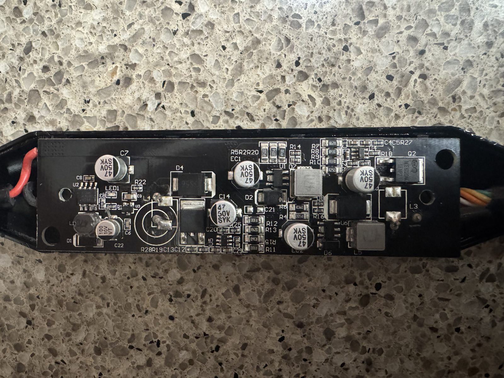
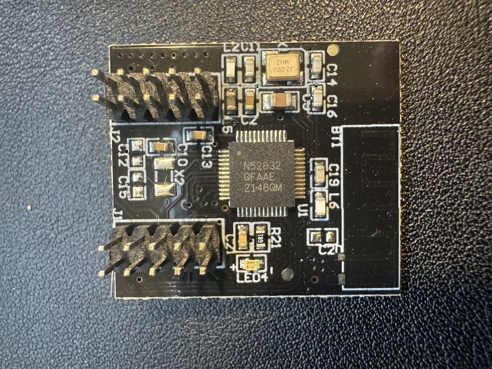
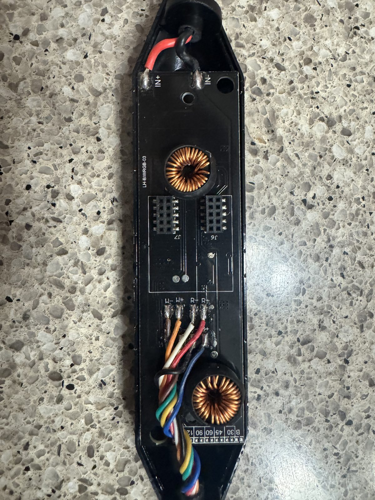
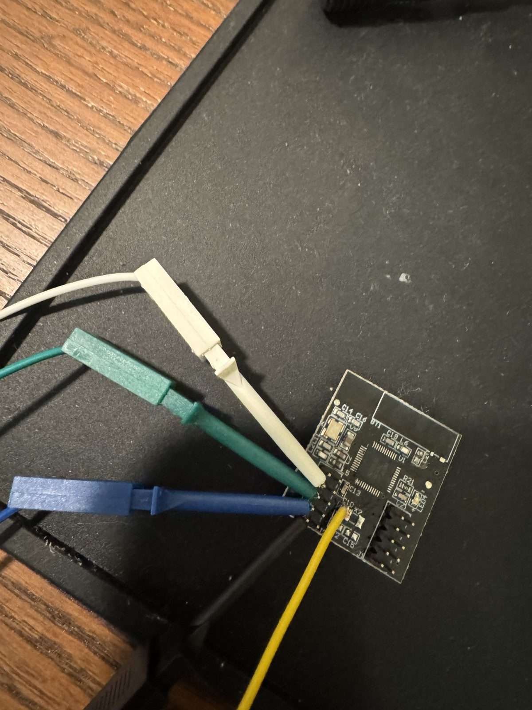
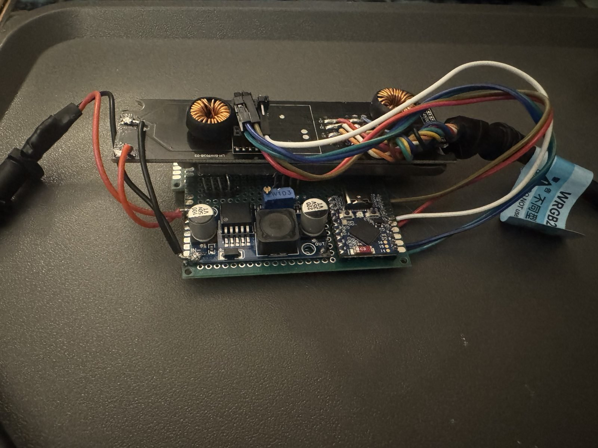
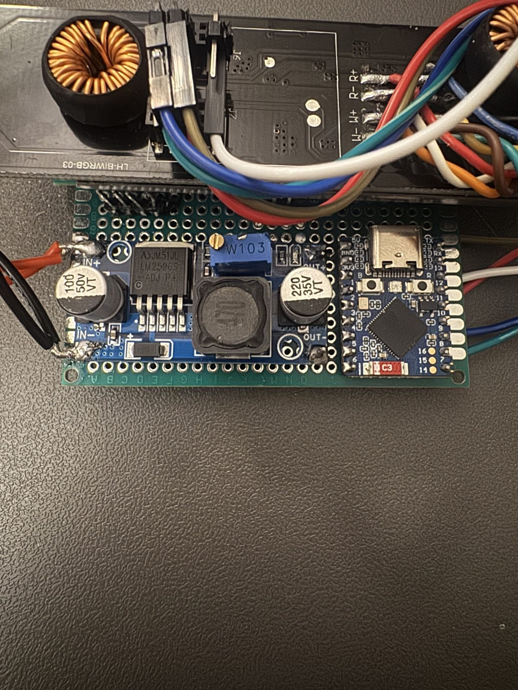
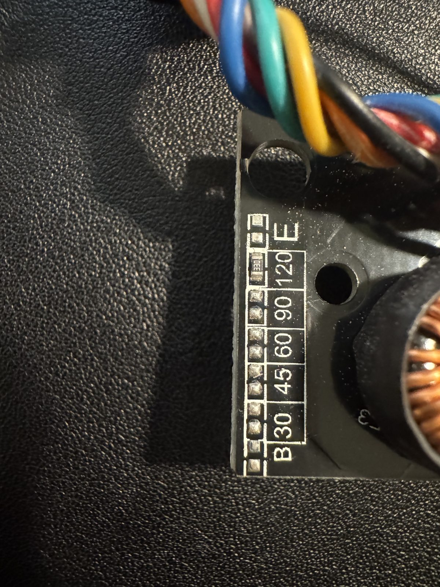

# Hardware Notes

Reverse-engineering notes for the Chihiros WRGB II Pro LED driver board, and how the ESP32-S3 is wired to it. Everything here comes from continuity and resistance measurements on my own unit and from reading part markings. There is no vendor schematic, so treat anything marked unresolved as exactly that.

Contents:

1. [The two boards](#1-the-two-boards)
2. [Header pinout](#2-header-pinout)
3. [LED driver channels](#3-led-driver-channels)
4. [Logic power stage](#4-logic-power-stage)
5. [Wiring the ESP32](#5-wiring-the-esp32)
6. [Powering the ESP32](#6-powering-the-esp32)
7. [Mounting](#7-mounting)
8. [Checklist before power-on](#8-checklist-before-power-on)
9. [Unresolved and raw notes](#9-unresolved-and-raw-notes)

---

## 1. The two boards

The controller housing on the light's cable holds two boards.

**The driver board** takes the 36 V DC input from the external power brick and carries four constant-current LED drivers, one per colour channel, plus a small supply for the logic.

**The daughterboard** is the factory controller: a Nordic nRF52832 Bluetooth module. It plugs into the driver board through two 10-pin headers, J1 and J2. This is the part the ESP32 replaces.

---

## 2. Header pinout

The J1 and J2 sockets sit on the underside of the driver board.

Each header pin was traced back to a pin on the nRF52832 by continuity.

### J1

| Pin | nRF52832 pin | nRF52832 function | Use on this board |
| --- | --- | --- | --- |
| J1.1 | 22 | P0.19 | **Green channel control** |
| J1.2 | 21 | P0.18 / TRACEDATA0 / SWO | **Red channel control** |
| J1.3 | 6 | P0.04 / AIN2 | Unresolved |
| J1.4 | 21 | P0.18 | Joined to J1.2. Not routed to a driver on this board |
| J1.5 | 38 | P0.26 | **White channel control** |
| J1.6 | 22 | P0.19 | Joined to J1.1. Not routed to a driver on this board |
| J1.7 | 23 | P0.20 / TRACECLK | Joined to J1.10. Not routed to a driver on this board |
| J1.8 | | GND | Q1 / Q3 sink (red channel) |
| J1.9 | | GND | Q2 sink (green channel) |
| J1.10 | 23 | P0.20 / TRACECLK | **Blue channel control** |

### J2

| Pin | nRF52832 pin | nRF52832 function | Use on this board |
| --- | --- | --- | --- |
| J2.1 | | GND | Ground |
| J2.2 | 25 | SWDCLK | Debug |
| J2.3 | 26 | SWDIO | Debug |
| J2.4 | 48 | VDD | 3.3 V supply to the daughterboard |
| J2.5 | 12 | P0.10 / NFC2 | Unresolved |
| J2.6 | 38 | P0.26 | Joined to J1.5. Not routed to a driver on this board |
| J2.7 | 10 | P0.08 | Unresolved |
| J2.8 | 9 | P0.07 | Unresolved |
| J2.9 | 8 | P0.06 | Unresolved |
| J2.10 | 7 | P0.05 / AIN3 | Unresolved |

Of the twenty pins, four carry the LED control signals: J1.1, J1.2, J1.5 and J1.10.

---

## 3. LED driver channels

Each channel is a buck-type constant-current LED driver running from the 36 V rail. The control signal from the header reaches the driver's dimming input through about 200 Ω.

| Channel | Header pin | nRF52832 GPIO | Driver IC | Switch | Catch diode | Inductor | Capacitor | How the LED(-) path was confirmed |
| --- | --- | --- | --- | --- | --- | --- | --- | --- |
| Red | J1.2 | P0.18 | U5 | Q1 / Q3 (external) | D4 | L4 | C14 | Q1 drain. About 200 Ω from the DIM trace to U5 |
| Green | J1.1 | P0.19 | U4 | Q2 (external) | D8 | L3 | C10 | Q2 drain. About 200 Ω from the DIM trace to U4 |
| White | J1.5 | P0.26 | U1 | Internal to U1 | D2 | L2 (47 µH) | | U1 pin 3. U1 pin 1 is about 200 Ω from J1.5 |
| Blue | J1.10 | P0.20 | U6 | Internal to U6 | D6 | L5 (47 µH) | | U6 pin 3. U6 pin 1 is about 200 Ω from J1.10 |

### Parts

| PCB reference | Part | Role |
| --- | --- | --- |
| U4, U5 | PT4121EE23F | Constant-current LED controller (red, green), drives an external MOSFET |
| U1, U6 | MK4025 | LED driver with integrated switch (white, blue) |
| Q1, Q2, Q3 | NCE6020AK | N-channel MOSFET |
| D4, D8 | SS56 (5 A) | Schottky catch diode |
| D2, D6 | SS36 (3 A) | Schottky catch diode |

### What that means for the control signal

- **PT4121 (red, green).** The datasheet specifies PWM dimming on the DIM pin from 100 Hz to 20 kHz. Below 0.3 V the LED is off, and at 2.5 V or above it runs at full rated current. A 3.3 V GPIO meets both thresholds, so no level shifting is needed.
- **MK4025 (white, blue).** No public datasheet was found. These channels were treated as higher risk until they were seen to dim in proportion to duty cycle, the same as the PT4121 channels.

The firmware drives all four at 1 kHz with 13-bit resolution, and caps the duty at 100/140 of full scale. The cap keeps the total LED load inside the power supply's rating, and is explained in the [README](README.md#full-brightness-would-overload-the-power-supply).

---

## 4. Logic power stage

The driver board makes its own 3.3 V for the daughterboard, delivered on J2.4, in two stages:

1. **Buck converter.** U2 (XL4001E1) with L1 (470 µH), D1 (SS16), C7 (47 µF 50 V input capacitor) and C22 (100 µF 10 V output capacitor) steps 36 V down to about 5 V.
2. **Linear regulator.** U3, a small 3-pin LDO marked `V1UH`, drops that 5 V to 3.3 V.

Two things to know about it:

- **It cannot power an ESP32.** U3 is sized for the nRF52832, which draws around 10 to 15 mA. An ESP32 with Wi-Fi active peaks at 500 to 600 mA. Dropping 5 V to 3.3 V at that current means dissipating over 0.85 W in a tiny regulator, which will shut down thermally or fail. See [section 6](#6-powering-the-esp32).
- **U2 is easy to kill.** Bridging its pin 2 (SW) to pin 3 (GND) while live destroys the internal switch and takes out the logic supply. The LED drivers run independently from the 36 V rail and are not affected if this stage dies.

---

## 5. Wiring the ESP32

The ESP32-S3 connects to the same four J1 pins the daughterboard used, plus ground.

| Driver board | Signal | ESP32-S3 pin | Driver |
| --- | --- | --- | --- |
| J1.2 | Red PWM | GPIO 11 | PT4121 |
| J1.1 | Green PWM | GPIO 7 | PT4121 |
| J1.10 | Blue PWM | GPIO 9 | MK4025 |
| J1.5 | White PWM | GPIO 13 | MK4025 |
| GND | Ground | GND | |

The ESP32 and the driver board must share a ground.

These GPIOs avoid the ESP32-S3 strapping pins (0, 3, 45, 46) and stay low or floating during boot, so the LEDs do not flash at power-on. The pin numbers are set in `src/config.h`. Change them there if you use a different board.

---

## 6. Powering the ESP32

**Do not power the ESP32 from the 3.3 V pin on the driver board.** The reason is in [section 4](#4-logic-power-stage).

Use a separate DC-DC buck converter instead:

1. Wire the converter's input to the 36 V input and ground on the driver board.
2. Adjust its output to 5 V before connecting the ESP32.
3. Wire the 5 V output to the 5 V pin on the ESP32 board, so the board's own regulator makes the 3.3 V.

This build uses an LM2596 module. Check the input rating of whatever module you use. It must be above 36 V, and many small modules are not: an MP1584 is limited to 28 V, and a standard LM2596 to 40 V, which leaves little margin. A module rated to 60 V is the safer choice.

Because the buck converter is fed from the same 36 V input as the driver board, the ESP32 and the drivers always power up and down together. If you power the ESP32 some other way, for example from USB while the light's supply is off, keep its outputs low until the 36 V rail is present.

If you try the board's 3.3 V pin anyway, watch the serial monitor. A boot loop with `Brownout detector triggered` as Wi-Fi starts means the regulator cannot cope, and you should disconnect it before the regulator is damaged.

---

## 7. Mounting

- **Heat.** The ESP32 gets warm with Wi-Fi active, and the light's aluminium housing and the driver ICs get hot. Mount the ESP32 away from the drivers' thermal path.
- **Antenna.** Inside the original metal housing the Wi-Fi signal is badly attenuated. This build uses a separate plastic project box. If you want to fit everything inside the original housing, place the antenna near the plastic end caps or use a board with an external antenna connector.

---

## 8. Checklist before power-on

- [ ] ESP32 ground is connected to driver board ground.
- [ ] The buck converter output has been set to 5 V and measured before the ESP32 was connected.
- [ ] No 36 V line can touch an ESP32 pin. That would destroy the ESP32 immediately.
- [ ] The firmware was built with your Wi-Fi details in `components/wifi_manager/include/secrets.h`.

---

## 9. Unresolved and raw notes

These are recorded as measured, without interpretation.

**Model select.** The driver board has a row of resistor positions labelled 30, 45, 60, 90 and 120, matching the lengths in the product range. At least one of the unresolved header pins may read which position is fitted, so the factory firmware can tell which model it is in. The replacement firmware does not use this.

**Resistance from the Q1 gate to each pin of U5 (PT4121EE23F):**

| U5 pin | Reading |
| --- | --- |
| 1 (VIN) | 12 kΩ |
| 2 (CSN) | 1 mΩ |
| 3 (DIM) | 1 mΩ |
| 4 (GND) | 1 MΩ |
| 5 (DRV) | 10 Ω |
| 6 (VCC) | 10 kΩ |

**Other traces:**

- U3 pin 1 connects to VDD at J2.4 and to J7.7.
- J1.2 connects to J6.9, and J6.9 is about 200 Ω from DIM.
- J6 pin numbering was taken zero-indexed, reading with Q1 and Q2 facing the reader.
- J6.9 may also connect to something on the white or blue channel. Unconfirmed.
