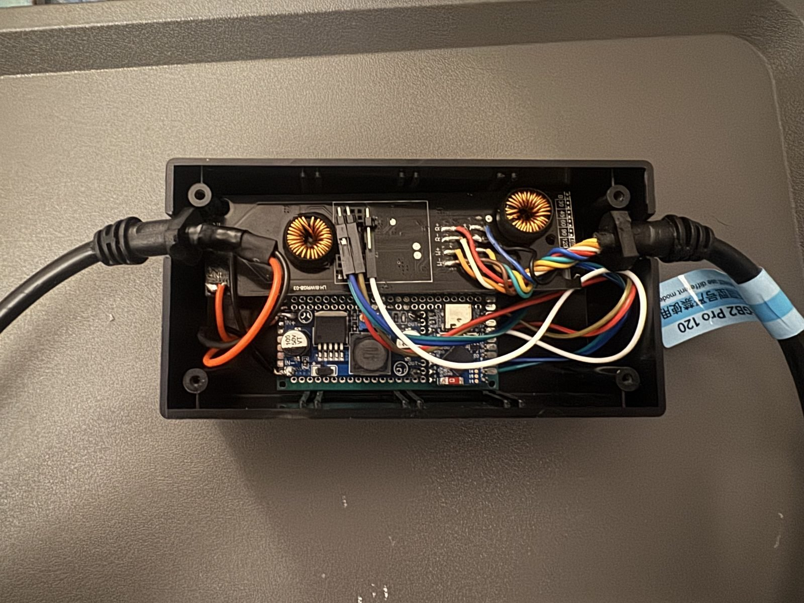
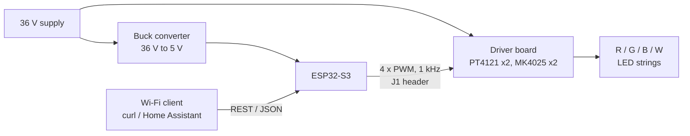
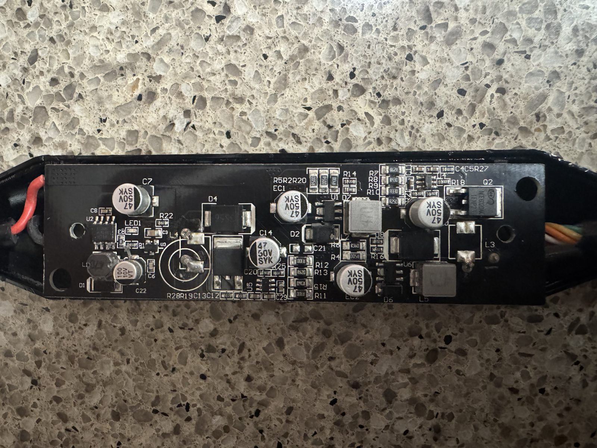
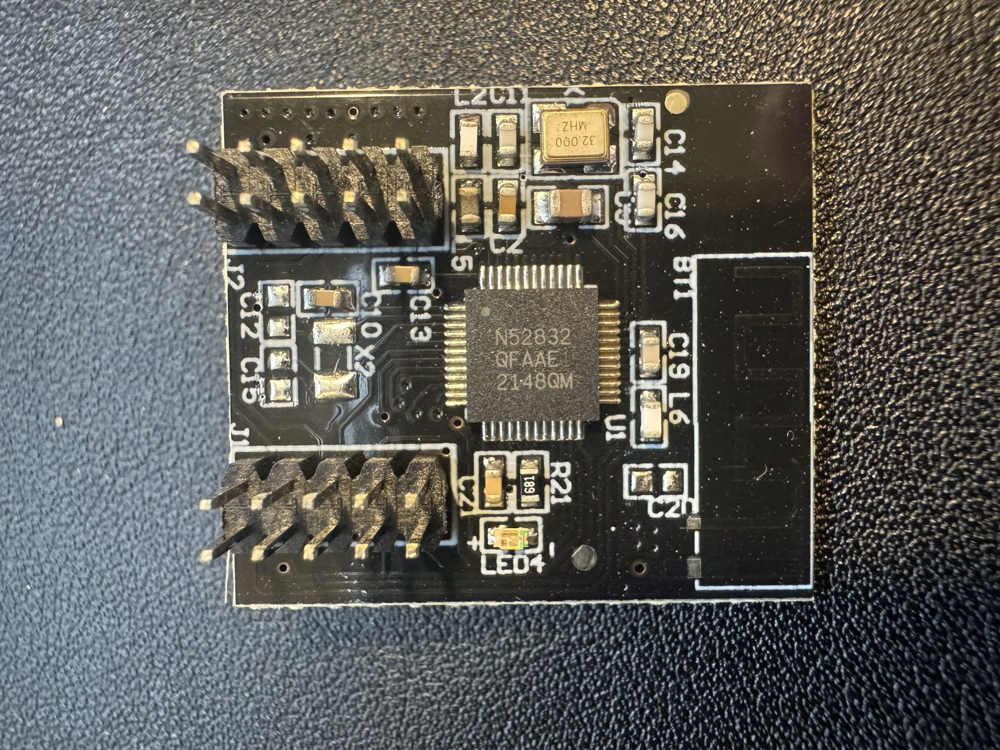
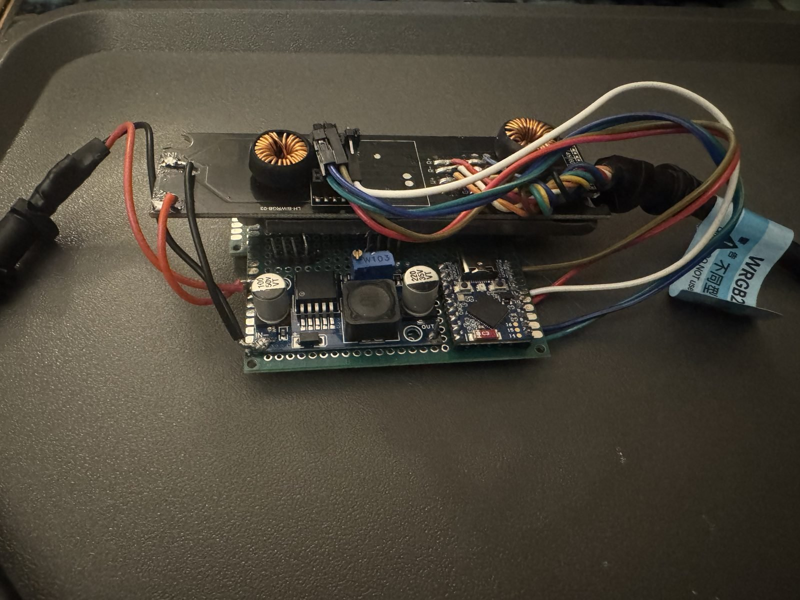
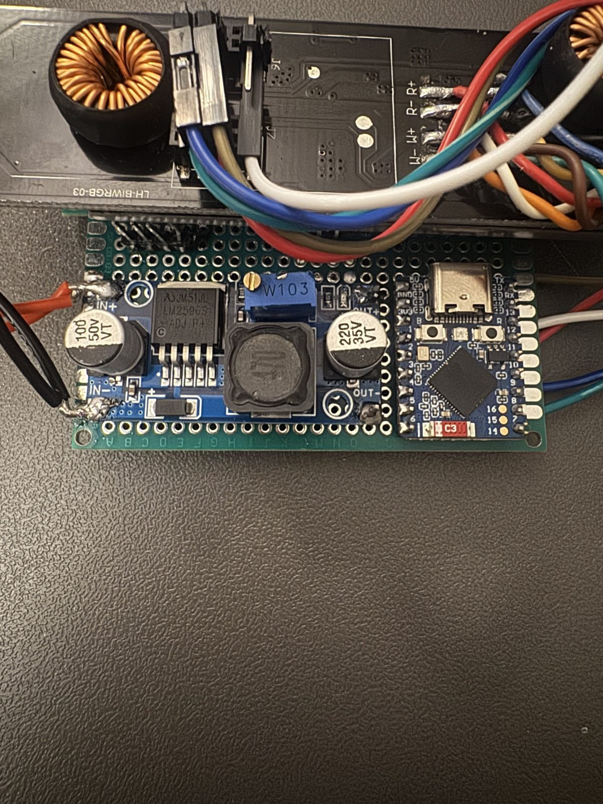

# Chihiros ESP32 LED Controller

Replacement controller for the Chihiros WRGB II Pro aquarium light. An ESP32-S3 takes the place of the factory Bluetooth daughterboard and drives the light's four LED channels (red, green, blue, white) directly with PWM, controlled over Wi-Fi through a small REST API.



Out of the box, the only way to control this light is the vendor's phone app over Bluetooth. My first fix for that was [AquaBle](https://github.com/caleb-venner/AquaBle), a Home Assistant integration that speaks the factory controller's Bluetooth protocol. It works, but it still depends on a Bluetooth link to a closed controller. I wanted the light on my network as a device I fully understood, with its daily schedule running on the device itself.

So this project removes the factory controller instead of talking to it. That meant working out how the driver board is wired, what the control signals look like, and how hard the LEDs can safely be driven. The controller has been running the light on my tank every day for a couple of months.

There is a longer write-up of the reverse-engineering and the build at [caleb-venner.github.io/projects/chihiros-esp32](https://caleb-venner.github.io/projects/chihiros-esp32/).

> Not affiliated with or endorsed by Chihiros. This is an independent project based on my own measurements of hardware I own, and it contains no vendor firmware. The light runs from an external power brick, so the work is all on the 36 V DC side, but it still means opening the controller housing and modifying the product. Use it at your own risk.

## How it works



The design leaves as much of the original light alone as possible. The driver board has one constant-current LED driver per channel, and each driver has a dimming input that the factory module drove from a GPIO. The ESP32 drives those same four header pins, so the light's own current regulation stays in place and the firmware only decides each channel's duty cycle.

The ESP32 and the driver board run from the same 36 V supply, so they always power up and down together.

## Reverse-engineering the driver board

Chihiros publish no schematic, so this was built up from the board itself.

| | |
| --- | --- |
|  |  |
| The LED driver board, out of its housing. | The factory controller: an nRF52832 module on two 10-pin headers. |

1. **Mapped each header pin** back to the nRF52832 by continuity. That separated power, ground and the SWD debug pins from everything else.
2. **Identified the driver ICs** from their markings. Red and green each use a PT4121 constant-current controller switching an external MOSFET. Blue and white each use an MK4025, which has its switch built in.
3. **Traced each control line** from a header pin, through a series resistor of about 200 Ω, to a driver's dimming input. Of the twenty header pins, only four turned out to matter.
4. **Checked the signals were compatible** before connecting anything. The PT4121 datasheet specifies PWM dimming from 100 Hz to 20 kHz with a logic-high threshold of 2.5 V, so a 3.3 V GPIO at 1 kHz drives it directly with no level shifting. The MK4025 has no public datasheet, so blue and white were treated as the riskier pair until they were seen to dim in proportion to the duty cycle.

| Channel | Driver board header | Driver IC | ESP32-S3 GPIO |
| --- | --- | --- | --- |
| Red | J1.2 | PT4121 + external MOSFET | 11 |
| Green | J1.1 | PT4121 + external MOSFET | 7 |
| Blue | J1.10 | MK4025 | 9 |
| White | J1.5 | MK4025 | 13 |
| Ground | J1.8 / J1.9 / J2.1 | | GND |

The complete header pinout, the per-channel driver chain, the component list and the measurements behind them are in [HARDWARE.md](HARDWARE.md).

## The build



A perfboard carries an LM2596 buck module and the ESP32-S3, with jumper wires to the driver board's J1 header. Three problems shaped it.

### The board cannot power an ESP32

The obvious move is to power the ESP32 from the 3.3 V pin that fed the Bluetooth module. Tracing that rail showed a buck converter stepping 36 V down to about 5 V, followed by a small linear regulator sized for a module drawing around 15 mA. An ESP32 with Wi-Fi active peaks at several hundred milliamps, which that regulator can neither supply nor dissipate. So the ESP32 gets its own buck converter from the 36 V input, feeding its 5 V pin, with a shared ground.



If you build one, check that your buck module's input rating is above 36 V. Many small modules are not.

### Full brightness would overload the power supply

The vendor app lets each channel go up to "140 %". Using the per-channel voltage and current figures from the app's power profile for this light, all four channels at 140 % come to about 187 W of LED load, and the power supply is rated for 127 W. The app handles this with a software power budget.

Full-scale PWM corresponds to that 140 % point, so this firmware takes a simpler route: 100 % in the API maps to 100/140 of full duty (about 71 %), and nothing can request more. At that cap, every channel at 100 % together comes to about 120 W. The limit holds for any combination of requests, with no budgeting logic to get wrong.

### The LEDs flashed at power-on

Some ESP32 pins are driven or pulled during boot, which would flash the light at full brightness every time it started. The four outputs avoid the ESP32-S3's strapping pins and use pins that stay low through the bootloader, and the PWM channels are set to 0 % before the network or the scheduler start.

## Firmware

About 700 lines of C on ESP-IDF, built with PlatformIO, kept as small modules that each do one job.

| Part | What it does |
| --- | --- |
| `src/led_driver.c` | LEDC PWM at 1 kHz with 13-bit resolution, one channel per colour. Every request goes through a single function that scales and caps the duty, so nothing else in the code can push a channel past the safe limit. |
| `src/scheduler.c` | FreeRTOS task that holds a manual colour or interpolates linearly between up to 24 daily keyframes, including across midnight. State is saved to NVS so the schedule survives a power cut. Time comes from SNTP, and auto mode stays dark until the clock is valid. |
| `src/light_api.c` | REST endpoints for reading and setting state. Input is range-checked as it comes in. |
| `components/web_core` | HTTP server and over-the-air firmware update into a two-slot OTA partition layout, so the box never has to be opened to change the code. |
| `components/wifi_manager` | Station-mode Wi-Fi with automatic reconnect. |
| `components/watchdog` | Task watchdog with a 2 second timeout. A hang reboots the chip, and the outputs come back up at 0 %. |

## Build and flash

Requirements: [PlatformIO](https://platformio.org/) and an ESP32-S3 board (developed on an ESP32-S3-Zero).

```bash
git clone https://github.com/caleb-venner/chihiros-esp32-controller.git
cd chihiros-esp32-controller

# Wi-Fi credentials live in a file that is not tracked by git
cp components/wifi_manager/include/secrets.example.h components/wifi_manager/include/secrets.h
# edit secrets.h, and the timezone in shared_config.h if you are not in Sydney

pio run -t upload
pio device monitor
```

Do the first flash at the desk with only USB connected. The serial log prints the IP address once the board joins the network:

```
I (1877) wifi_manager: Successfully connected!
I (1877) wifi_manager: ESP32 IP Address: 192.168.1.50
```

Pin assignments and PWM settings are in `src/config.h`.

## API

Levels are percentages from 0 to 100. Keyframe times are minutes since local midnight.

**Read the current state**

```bash
curl http://192.168.1.50/api/status
```

**Manual mode**

```bash
curl -X POST -H "Content-Type: application/json" -d '{
  "mode": "manual",
  "manual": { "red": 50, "green": 25, "blue": 60, "white": 25 }
}' http://192.168.1.50/api/state
```

**Auto mode** with a daily schedule. This example ramps up from 13:00 to 13:30, holds until 20:30, fades to a dim blue-white by 21:00, and switches off at 22:00.

```bash
curl -X POST -H "Content-Type: application/json" -d '{
  "mode": "auto",
  "keyframes": [
    { "time_min": 780,  "r": 0,  "g": 0,  "b": 0,  "w": 0 },
    { "time_min": 810,  "r": 40, "g": 20, "b": 45, "w": 25 },
    { "time_min": 1230, "r": 40, "g": 20, "b": 45, "w": 25 },
    { "time_min": 1260, "r": 0,  "g": 0,  "b": 2,  "w": 2 },
    { "time_min": 1315, "r": 0,  "g": 0,  "b": 2,  "w": 2 },
    { "time_min": 1320, "r": 0,  "g": 0,  "b": 0,  "w": 0 }
  ]
}' http://192.168.1.50/api/state
```

The schedule is saved to flash and applied immediately, picking up at the correct point for the current time of day.

**Over-the-air update**

```bash
curl -X POST --data-binary @.pio/build/light-controller/firmware.bin http://192.168.1.50/api/update
```

## Status and limitations

The controller has run the light on my tank every day for a couple of months, with no factory module installed. Four-channel PWM with the duty cap, manual and scheduled modes, persistence across power cuts, network time, watchdog recovery and over-the-air updates all work.

Known limitations:

- The API has no authentication, including the update endpoint. Run it on a trusted network only.
- Wi-Fi credentials are compiled in. There is no provisioning flow.
- Scheduled fades step in whole percentages and do not use the PWM's full 13-bit resolution, so long fades at low brightness move in small discrete steps.

Next: replace the perfboard, buck module and jumper wires with a single PCB that has its own 36 V buck converter and plugs straight into the J1 and J2 headers, small enough to fit back inside the light's original housing.

## Licence

MIT. See [LICENSE](LICENSE).
